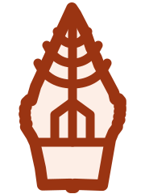
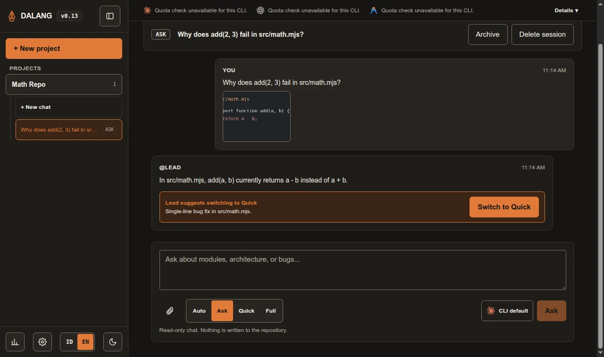

<p align="center">
  
</p>

<h1 align="center">Dalang</h1>

<p align="center">Work with Claude Code, Codex, and Antigravity in your terminal or browser.</p>

<p align="center">
  <a href="#install"><strong>Install</strong></a> ·
  <a href="#terminal-quick-start">Terminal quick start</a> ·
  <a href="#browser-workspace">Browser workspace</a> ·
  <a href="./docs/TROUBLESHOOTING.md">Common errors</a> ·
  <a href="./docs/README.md">All docs</a> ·
  <a href="https://github.com/azmifauzan/dalang/releases">Releases</a> ·
  <a href="https://www.npmjs.com/package/dalang-cli">npm</a>
</p>

> [!IMPORTANT]
> **Dalang does not start because the database schema is newer than your build?**
> Older versions may also fail when you run `dalang update`. Stop Dalang and install the latest version directly:
>
> ```sh
> npm install -g dalang-cli@latest
> dalang --version
> dalang
> ```
>
> The installed version must support your database schema; the [upgrade table](docs/INSTALL.md#database-upgrades) lists which release added each schema. Do not delete your database. [More help](docs/TROUBLESHOOTING.md#database-schema-is-newer-than-this-dalang-build)

Dalang runs **Claude Code, Codex CLI, and Antigravity CLI** from a team room in your terminal or a browser workspace on your machine. Open a Git repository and start a chat with the Lead. Ask a question, plan a small fix, or work through a larger feature. When agents change code, Dalang runs each task in a separate Git worktree and brings the verification output, review, and diff back for your merge decision. A workspace folder whose top-level folders are their own Git repositories opens as one project, with a worktree, diff, and merge per repository ([how it works](docs/USAGE.md#workspace-projects-with-nested-repositories)).

Start with one signed-in CLI or give planning, coding, and review to different providers. Dalang uses the logins you already have. You can work in English or Indonesian.

## Choose a mode

| Mode | What you can do |
| --- | --- |
| **Ask** | Get a read-only answer about the repository. |
| **Quick** | Review a one-task plan, run it, and decide whether to merge in the same chat. |
| **Full** | Discuss a larger change, approve a brief and plan, run independent tasks in parallel, and review each diff before merging. A running coder can also hand independent parts of its task to another profile or CLI through a local MCP server. Each part is reviewed and merged into the task branch before you review the whole. |

## Install

You need **Node.js 24+**, **Git**, and at least one supported agent CLI installed and signed in. Linux and WSL 2 use `bubblewrap`, and macOS uses `sandbox-exec`. Native Windows uses Codex MXC when available and asks for consent before unconfined task execution. [Platform requirements and CLI sign-in](docs/INSTALL.md)

Install the latest release from npm:

```bash
npm install -g dalang-cli@latest
dalang doctor
dalang
```

## Terminal quick start

1. Run `dalang` in an interactive terminal. The first-run wizard checks your CLIs, configures the team, and opens a project.
2. Use `/project open .` to register the Git repository in your current folder, or `/project create ./my-project` to start a new one. Use `/project list` to find existing projects.
3. Type a question to start in Ask. Use `/model` to choose the Lead's provider, model, and effort, or `/mode quick` to plan a small change. Review it with `/diff`, then use `/merge` when ready.

While an agent works, the status line shows a spinner, elapsed time, and a short activity summary. Replies render Markdown in the timeline. Use **↑ / ↓** to recall prompts, `/resume` to reopen a saved chat, and `/web` to open the same chat in your browser. [Terminal walkthrough and command reference](docs/USAGE.md#terminal-team-room)

## Browser workspace

Run `dalang web` to open the workspace at `http://127.0.0.1:4173`. The sidebar holds saved chats, and the composer supports image attachments with Claude Code and Codex. Web Config includes task routing, fallback accounts, authentication, and automations. [Browser walkthrough](docs/USAGE.md#browser-workspace)



On Windows, task verification uses `cmd.exe`; use Windows-compatible commands. Existing repository instructions are preserved, and installations without symlink privileges use files that point agents to `PROJECT.md`. [Windows setup](docs/INSTALL.md#native-windows)

### Docker

From the source checkout, run `docker compose up --build -d` and open `http://127.0.0.1:4173`. The image includes all three CLIs. Sign in to the providers you use from inside the container. [Docker setup](docs/INSTALL.md#run-with-docker)

Dalang opens without an app password by default. Enable one in **Config → Security → DALANG login**. [Set up a DALANG password](docs/INSTALL.md#require-a-dalang-password)

## Documentation

| Guide | What it covers |
| --- | --- |
| [Install and update](docs/INSTALL.md) | npm, Docker, platform requirements, upgrades, and backups |
| [Use Dalang](docs/USAGE.md) | Terminal keys and commands, browser chat, planning, review, and Git |
| [Providers and accounts](docs/PROVIDERS.md) | CLI sign-in and updates, models, separate accounts, routing, and fallback |
| [Sandbox and permissions](docs/SANDBOX.md) | Local access, optional password, filesystem confinement, Antigravity keyring access, and Git safety |
| [Troubleshooting](docs/TROUBLESHOOTING.md) | Startup, login, quota, sandbox, and Git problems |

[All documentation](docs/README.md) · [Changelog](CHANGELOG.md) · [Report an issue](https://github.com/azmifauzan/dalang/issues)

## License

[MIT](LICENSE) · [Wayang artwork credits](packages/web/src/assets/wayang/CREDITS.md) · [Provider mark credits](packages/web/src/assets/providers/CREDITS.md)
