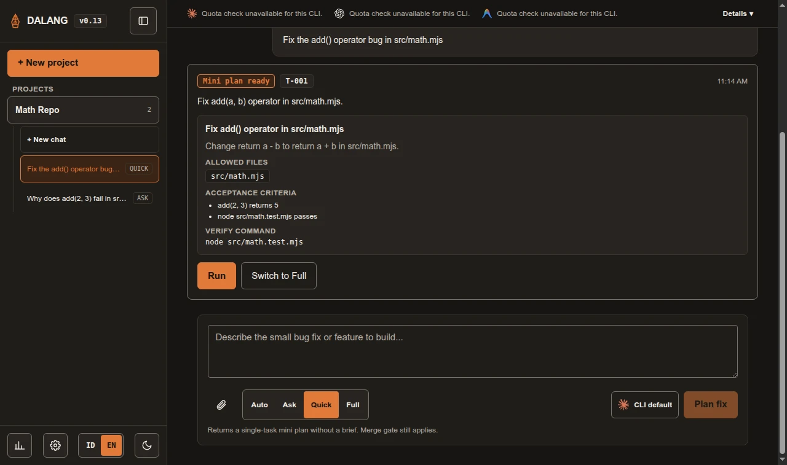

<p align="center">
  
</p>

<h1 align="center">Dalang</h1>

<p align="center">Ask about your code, plan changes, and review agent work in one local workspace.</p>

<p align="center">
  <a href="#install"><strong>Install</strong></a> ·
  <a href="./docs/USAGE.md">User guide</a> ·
  <a href="./docs/README.md">All docs</a> ·
  <a href="https://github.com/azmifauzan/dalang/releases">Releases</a> ·
  <a href="https://www.npmjs.com/package/dalang-cli">npm</a>
</p>



Dalang runs **Claude Code, Codex CLI, and Antigravity CLI** from a browser workspace on your machine. Open a Git repository and start a chat with the Lead. Ask a question, plan a small fix, or work through a larger feature. When agents change code, Dalang runs each task in a separate Git worktree and brings the verification output, review, and diff back for your merge decision.

Start with one signed-in CLI or give planning, coding, and review to different providers. Dalang uses the logins you already have. You can work in English or Indonesian.

## Choose a mode

| Mode | What you can do |
| --- | --- |
| **Ask** | Get a read-only answer about the repository. |
| **Quick** | Review a one-task plan, run it, and decide whether to merge in the same chat. |
| **Full** | Discuss a larger change, approve a brief and plan, run independent tasks in parallel, and review each diff before merging. |

The composer lets you choose a mode, CLI, model, and reasoning effort. Reopen saved chats from the project sidebar. Use **Config** to set team roles, account directories, and fallback targets. The project header shows quota windows when the CLIs report them, and **Statistics** summarizes runs, tokens, and API-equivalent cost estimates.

## Install

You need **Node.js 24+**, **Git**, and at least one supported agent CLI installed and signed in. On Linux and WSL 2, install `bubblewrap`. On macOS, Dalang uses the built-in `sandbox-exec`. [Platform requirements and CLI sign-in](docs/INSTALL.md)

Use npm to try Dalang without a global install.

```bash
npx dalang-cli doctor
npx dalang-cli
```

Dalang starts at `http://127.0.0.1:4173` and opens your browser. Leave the terminal running while you work.

Install the `dalang` command if you use it regularly.

```bash
npm install -g dalang-cli
dalang doctor
dalang
```

## Your first project

1. Follow the setup wizard to check your CLIs and choose your Lead, coders, and reviewer.
2. Open an existing Git repository or create a project. Ask the Lead about the code, or choose **Quick** or **Full** before sending a change request.
3. For Quick and Full work, inspect the review and Git diff before merging. The Full flow also lets you run integration tests, push, or open a GitHub pull request from **Review & merge**.

[Walk through a project with screenshots](docs/USAGE.md) · [Upgrade from an earlier release](docs/INSTALL.md#update-dalang)

## Documentation

| Guide | What it covers |
| --- | --- |
| [Install and update](docs/INSTALL.md) | Linux, macOS, WSL 2, npm, source builds, and data locations |
| [Use Dalang](docs/USAGE.md) | Setup, planning, runs, review, Git, and settings |
| [Providers and accounts](docs/PROVIDERS.md) | CLI sign-in, models, separate accounts, routing, and fallback |
| [Sandbox and permissions](docs/SANDBOX.md) | Local access, filesystem confinement, Antigravity keyring access, and Git safety |
| [Troubleshooting](docs/TROUBLESHOOTING.md) | Startup, login, quota, sandbox, and Git problems |

[All documentation](docs/README.md) · [Changelog](CHANGELOG.md) · [Report an issue](https://github.com/azmifauzan/dalang/issues)

## License

[MIT](LICENSE) · [Wayang artwork credits](packages/web/src/assets/wayang/CREDITS.md) · [Provider mark credits](packages/web/src/assets/providers/CREDITS.md)
