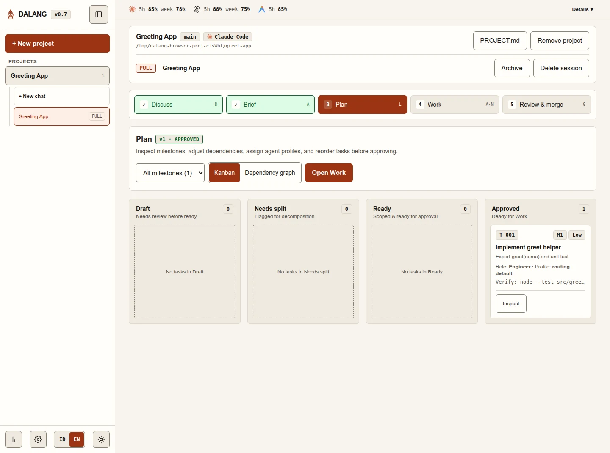
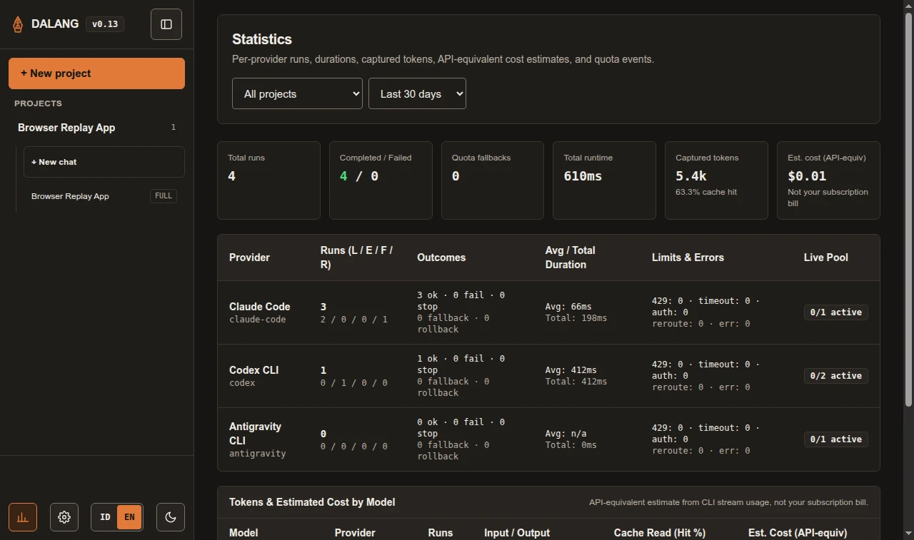

# Use Dalang

Use `dalang` for the terminal team room or `dalang web` for the browser workspace. Both use the same projects and conversations. [Install and start Dalang](INSTALL.md)

## Terminal team room

Run `dalang` in an interactive terminal to open the team room. If a Dalang server is already running on `DALANG_PORT` (default `4173`), `dalang` attaches to it; otherwise it starts the server in the same process and stops it when you exit. Use `dalang room --port <number>` for a server on another port. Run `dalang web` for the browser workspace. When stdin or stdout is not a terminal, `dalang` runs `dalang web` instead.

### Open a project and start a chat

1. On a fresh install, complete the four-step wizard to check your agent CLIs, configure the team, and open a project. Run `/wizard` to reopen it later.
2. Use `/project open .` to register the Git repository where you launched Dalang, or `/project create ./my-project` to create a project and initialize Git. Use `/project list` and `/project <n>` or `/project <name>` to switch.
3. Type a question and press Enter. The room starts with a new chat for the project containing your current directory, or the first registered project when none matches. Use `/resume` to continue an earlier chat.

### Run and review work in the terminal

- **Ask:** Type a question for the Lead. Use `/model` to choose the provider, model, and reasoning effort for Lead messages.
- **Quick:** Run `/mode quick`, then describe the change. Read the draft task, allowed files, and verification command. Press `y` and Enter at the run gate, or use `/run`. Inspect the review and `/diff`, then press `y` at the merge gate or use `/merge`.
- **Full:** Run `/mode full`, discuss the scope, and use `/finish` to draft the brief. Approve the brief to generate a plan. Approve the plan to start work. Use `/diff T-001` and `/merge T-001` for an individual task, or `/web` to inspect the same session in the browser.

### Read the timeline and live status

- **Header:** the Dalang mark (the Gunungan) on the left, then four rows:
  - the project, session title, composer mode, and whether the room runs its own server (`embedded`) or attached to one;
  - quick stats: the 5 hour (`5h`) and weekly (`wk`) limit left for each installed provider, the same numbers as the web usage bar, red at 20% or less, refreshed on the interval set in `/config`;
  - the model the Lead will answer with next, and where it comes from: chosen with `/model`, the open session, or the Lead profile. A new chat uses the Lead from Config (`/config` or the browser's **Config → Agents → Team**); a session already started keeps its own CLI and model, so use `/model` or `/new` after changing the Lead;
  - the agents running now with their models (`@coder-small Antigravity · gemini-4-hydrogen`), or the project folder when none runs.
- **Team timeline:** the Lead, coders, and reviewer post plans, task status, diff stats, verification, and review verdicts under their own profile names. Agent replies render headings, emphasis, lists, code, and link labels. The browser chat shows the same feed.
- **Reply as it is written:** while the Lead, or a profile you asked with `@<profile>`, answers in Ask mode, the latest lines of the reply appear under the timeline with `writing...`, and the finished message replaces them. Claude Code, Codex, and Antigravity stream their text as they write it. A provider run without live output shows each finished message instead.
- **Working status:** the line above the composer shows an animated spinner, elapsed time, the agent and provider, and a short activity such as reading files, running a command, or writing a response. `+N` counts other active agents. When a provider has no recognized activity event, the line shows a general working status.
- **Mention routing (`@<profile>`):**
  - An untagged message, or `@lead`, goes to the Lead in the composer mode (`ask`, `quick`, or `full`).
  - `@<profile>` for an idle profile (such as `@reviewer` or `@coder-small`) asks that profile in read-only Ask mode without changing the session mode.
  - `@<profile>`, or `@coder`, while that coder is running sends your message as a steering note. A run on a CLI that cannot take steering refuses the message.
- **Gates:** when a Quick plan, brief, plan, or finished task waits for you, type `y` or `n` and press Enter. `n` leaves the item waiting; a task waiting for merge is only discarded with `/reject`.
### Commands and keyboard shortcuts

| Command | What it does |
| --- | --- |
| `/mode [ask\|quick\|full]` | Show the composer mode, or switch it |
| `/project [list\|<n\|name>\|open [path]\|create [path]]` | List, switch, open, or create a project |
| `/model` | Choose the Lead's model from every connected provider, then its reasoning effort. The active model is marked. Applies to your next messages until you pick another or go back to the Lead's own setting |
| `/config` | Language, provider limits refresh, update checks, agent CLIs (status, re-check, Antigravity keyring), and the agent team (provider, model, and effort per role) |
| `/wizard` | Open the setup wizard again |
| `/new` | Start a new session |
| `/resume [n\|id]` | Pick an earlier session of this project from a list, newest first, and continue it |
| `/diff [taskId]` | Open the task diff in `$PAGER` (`less -R`, or `more` on Windows) |
| `/merge [taskId]` | Merge a task that is waiting for merge |
| `/reject [taskId] [note] [--requeue]` | Discard a task's work, or send it back to the queue |
| `/stop [taskId]` | Stop running work |
| `/run` | Approve the draft plan and start it |
| `/finish` | End Discuss in Full mode and draft the brief |
| `/web` | Open the browser on the same project and session |
| `/help` | Show commands and shortcuts |
| `/exit` | Leave the room (Ctrl+C works too) |

Use `↑` and `↓` in the composer to recall prompts. Moving past the newest prompt with `↓` restores the current draft. `/resume` also makes the selected chat's saved prompts available. Press Enter to submit only after you have reviewed or edited the recalled text.

Typing `/` or `@` opens a list. Move with `Up` and `Down`; `Enter` runs the highlighted command or fills in the highlighted `@<profile>`, and `Tab` fills either one in without running it. In `/config`, `/model`, and the wizard, `Up` and `Down` move, `Enter` chooses, and `Esc` goes back.

Scroll older messages with the mouse wheel (3 rows a notch), `PageUp` / `PageDown`, or `Ctrl+U` / `Ctrl+D`. The footer shows how many rows are above and below. Because the room asks the terminal to report the wheel, plain click-and-drag text selection stops working: hold `Shift` while you drag to select and copy. Set `DALANG_NO_MOUSE=1` to leave the mouse to the terminal; the keyboard scrolling still works. Theme, the app password, and factory reset stay in the web **Config**.

## Browser workspace

Run `dalang web` to open the local workspace, usually at `http://127.0.0.1:4173`. From the terminal room, use `/web` to open the active project and chat. In the walkthrough below, screenshots show demo repositories and replayed responses.

## Set up your team and project

On your first launch, the wizard checks your agent CLIs, proposes a team, and opens your first project. If an agent shows **LOGIN NEEDED**, sign in from your terminal and refresh the check. One signed-in provider can fill every role.


- **Lead (Semar)** asks questions and drafts the brief and task plan.
- **Coders (Bima and Kresna)** implement tasks. You can use different models for simple and complex work.
- **Reviewer (Arjuna)** checks the changes against the task. Pick a different provider from the coder if you want a cross-provider review.
- **Fallback** is an alternate CLI configuration Dalang can use when the primary cannot run.

Choose **New project** to initialize a folder with Git, or **Open existing repo** to work on an existing checkout. Enter the local folder path. Use the sidebar to switch projects or add another one later.

Dalang uses `PROJECT.md` for repository instructions and can link `CLAUDE.md` and `AGENTS.md` to it. Use the **PROJECT.md** button to review the file or check the links. Keep build commands, test commands, and project conventions here.

On native Windows without symlink privileges, Dalang creates instruction files that refer agents to `PROJECT.md`. Existing user-owned instruction files remain in place. The native Windows runner uses `cmd.exe` for task verification and integration; use Windows-compatible commands, or open the project from WSL 2 for POSIX commands.

## Choose Ask, Quick, or Full

A project opens into a chat with the Lead. Pick a mode beside the send button. Dalang saves the session when you send the first message.

| Mode | Use it for | What happens |
| --- | --- | --- |
| **Ask** (default) | Questions about the repository | The Lead reads the repository and answers in chat. Dalang saves the transcript and keeps technical logs in an ignored directory. |
| **Quick** | A small bug fix or feature | The Lead drafts a single task with allowed files, acceptance criteria, and a verify command. You run, review, and merge it from the chat. |
| **Full** | A larger change | You discuss scope, approve a brief and plan, then use the Work and Review views to run and merge tasks. |

### Ask about the code

The model chip beside the send button opens a picker for the provider, model, and reasoning effort. A new chat starts with the Lead in **Config → Agents → Team**; a chat you already started keeps the CLI and model it uses. While the Lead works, the chat shows the CLI name, elapsed time, progress, and any streamed reply. Expand **Show technical log** to inspect raw output.

### Attach images

Choose Claude Code or Codex, then click the paperclip at the lower left of the composer or paste an image. In Ask, Quick, and Full, send up to three PNG, JPEG, or WebP images per message, each up to 4 MiB. Write a prompt if you want to give the CLI extra context. Use the preview's **Remove** button to drop an image before sending. Dalang sends the images to the selected provider for that turn and keeps them in the chat transcript.


### Run a Quick fix

1. Select **Quick** and describe the change. Check the proposed task, allowed files, acceptance criteria, and verify command. The verify command runs inside the task worktree, and Dalang rewrites the project's absolute path in it to a relative one.
2. Click **Run**. Dalang runs the task in a Git worktree, executes the verify command, and runs automated review. If the host sandbox is unavailable, the run requires explicit unconfined consent.
3. Open **Show diff** and inspect the review. Click **Approve & merge** when ready, or send the task back with feedback.


If the Lead finds the request needs a broader plan, use **Switch to Full (keeps findings)** to take the request and findings into Discuss.

### Continue or manage a chat

- Use **New chat** in the project sidebar or reopen a saved session to restore its conversation and work. Click the session title to rename it. The header also offers archive and delete actions, with a confirmation before deletion.
- Sending a higher-mode message can move a session from Ask to Quick or Full, or from Quick to Full. The conversation carries over. Ask stays available in both work modes and keeps the session's current mode. Quick becomes available again after Full work is complete.
- Only one session per project can hold unfinished work. In the terminal, use `/resume` to find that session or `/web` to manage it in the browser. Other sessions can still Ask. Finish merging the first session's work or use **Discard work** to free the project. Discarding stops its runs and removes unmerged task branches and worktrees. Merged code stays on the target branch.
- The desktop sidebar can collapse to an icon rail. Dalang remembers your choice. On small screens, use **Menu** to open the sidebar.

## Full walkthrough

## 1. Discuss the goal

Choose **Full** beside the send button and describe what should change, what must stay in scope, and how you will know it works. The model chip in the composer chooses the CLI and model for each message.

For example, send this goal in a small Node.js project.

> Add a greeting helper that returns a formatted message from a name. Include tests for normal and empty input. Keep the module dependency-free.

Click **Send** (the button reads **Send to Lead** once the discussion has started). Answer any question cards, add notes if needed, then click **Submit answers & continue**. When the goal is clear, click **Enough, write the brief**.

## 2. Approve the brief

In **Brief**, check the proposed scope, features, constraints, and assumptions. Edit the draft and click **Save edits**, or use **Revise with Lead** to ask for a new version. Click **Approve brief (Gate 1)** when it matches your intent, then **Generate plan**.

## 3. Approve the plan

In **Plan**, inspect tasks on the **Kanban** board or switch to the **Dependency graph**. Open a task to edit its goal, allowed files, dependencies, profile override, acceptance criteria, and verify command. The verify command should be a command you would run locally, such as `node --test`.



Break broad tasks into smaller ones with clear file boundaries. Use dependencies for work that must happen in order. Dalang queues independent tasks in parallel when capacity permits and holds back tasks with overlapping allowed files. Check all tasks, then click **Approve plan** and open **Work**.

## 4. Run the work

Click **Start work** to run the approved queue. Dalang uses a separate Git worktree for each task. The wayang stage and **Activity feed** show progress. Click a figure or select a task under **Tasks & live logs** to inspect its output, attempts, and changed files. **Routing & queue** shows profile assignments and fallbacks. **Dependency graph** shows execution waves and what is waiting.


- When **Message to the running agent** appears, use it to add a clarification to the active task. Claude and Codex support this with their session protocols.
- Use **Stop** to interrupt an individual task or **Stop all runs** for the queue. Stopping a parent task also stops its delegated subtasks. Use **Resume session** when available to continue a stopped task with its existing worktree and conversation.
- If a provider fails during coding and a backup is available, the backup gets recent run events and a partial diff along with the task brief.
- During execution, a running coder can split independent parts of its task onto other profiles or providers via DALANG's local MCP server (`delegate_task`, `task_status`, `task_cancel`). Each subtask runs in its own worktree branched from the parent branch, passes verify and automated review, and merges back into the parent branch so the parent's review and Gate 2 diff include the combined result. Delegated subtasks appear under their parent task in **Tasks & live logs** and **Dependency graph**. Delegation is available to Claude Code and Codex coders; Antigravity cannot receive a per-run MCP server, so its coders work without the delegation tools. Native CLI subagents (Claude `Task` tool calls and Antigravity batches) appear read-only in the run inspector.
- Use **Retry** for a failed or stopped task. Where **Resume session** is available, use it to continue the provider session.
- To restore a pre-run state, select the run and use **Rollback to pre-run checkpoint**. Dalang can refuse a rollback when it would lose uncommitted work or commits made outside Dalang. [Rollback troubleshooting](TROUBLESHOOTING.md)
- If the sandbox is unavailable, see **Config → Security** for platform setup. Dalang asks for explicit confirmation before running tasks without filesystem confinement. [Sandbox and permissions](SANDBOX.md)

## 5. Review and merge

After a coder finishes, Dalang runs the task’s verification and an automated review. Open **Review & merge** and select a task. Read the review findings, open **Show verify output**, and inspect the **Branch diff** before deciding.


- **Approve and merge** adds the task changes to the project’s target branch. Dalang refuses a merge only when an uncommitted file in the target repository is also changed by the task, leaving unrelated uncommitted edits intact. Dalang asks for a separate override if automated review failed.
- **Reject and send back** lets you leave feedback and optionally requeue the task for another attempt.
- Set the **Integration command** for project-wide checks, such as `npm test`. Run it after a merge using the checkbox, or manually with **Run integration suite**.

### Workspace projects with nested repositories

You can open a workspace folder whose top-level subdirectories are their own standalone Git repositories (for example, a workspace root that ignores `frontend/`, `backend/`, and `scheduling-service/`).

- At task start, Dalang creates the root worktree and one worktree per top-level nested repository at the same relative path, each branched from that repository's currently checked-out branch. Paths stay root-relative (`frontend/...`) across plans, `files_allowed`, verify commands, and prompts.
- Checkpoints, hidden refs, scope checks, review diffs, and rollbacks run per repository and are joined with the repository prefix. The **Review & merge** and **Quick** diff views label each repository.
- Gate 2 merges each changed repository into its base branch (one merge commit per changed repository). Unrelated uncommitted changes stay in place; a merge is refused only if an uncommitted file overlaps a file modified by the task. If a later repository fails to merge, earlier repositories are restored to their pre-merge commit with `git reset --keep`.
- Push and pull request actions push each changed repository to its own configured Git remote and open a PR per repository when requested.
- Delegated subtasks receive nested worktrees branched from the parent task's branches and merge back per repository. Git submodules and nested repositories below the top level are not managed as workspace repos.

If the platform sandbox is unavailable, post-merge integration needs explicit unconfined consent in the current view. Without confinement or consent, the check is marked **skipped**. You can grant consent and run it manually. Required task `result.json` files are orchestration metadata.

### Push or open a pull request

In **Remote push and pull request**, select the Git remote (usually `origin`). After approving a merge, you can push the branch or push and open a PR. You can also save post-merge defaults for the project. Pushing uses your normal Git credentials. Opening a PR also requires `gh auth login` and a branch with changes relative to the PR base. [Git troubleshooting](TROUBLESHOOTING.md#push-or-pull-request-fails-in-review-and-merge)

## Settings and statistics

| Where | What you can do |
| --- | --- |
| **Config → General** | Choose English or Indonesian for the UI and Lead/Reviewer output, set the theme, reopen the wizard, and manage quota refresh and update notifications. |
| **Config → Agents** | Check CLI versions, logins, model lists, and quotas. Use **Update CLI** to update an installed provider or **Refresh CLI status** after signing in. |
| **Config → Automation** | Create cron schedules and HMAC-signed webhooks, inspect recent automated runs, and issue `read-only` or `full-access` loopback MCP tokens for Claude Code or Codex in a terminal. |
| **Config → Team** | Edit profiles, models, reasoning effort, account directories, fallback targets, timeouts, and parallel slots. |
| **Config → Task routing** | Order rules by role and task complexity. The first matching rule selects the primary and can set a fallback. |
| **Config → Security** | Enable or disable DALANG password login, check sandbox status, and manage the Linux Antigravity keyring opt-in. |
| **Config → About** | Check your version, look for updates, and open support docs. |
| **Statistics** | Filter Lead, execution, fix, and review runs by project and time window. See duration, failures, fallback events, reported tokens, and API-equivalent cost estimates. |



The provider limits bar shows the tightest five-hour and weekly windows each installed CLI reports. **Details** lists the available windows, reset times when reported, and a refresh button. Dalang refreshes when a run finishes and every five minutes while the page is visible. Choose three, five, or ten minutes in **Config → General**. [Providers and accounts](PROVIDERS.md)

When DALANG login is enabled, use the **Sign out** icon on the far right of the sidebar footer. [Set or disable the app password](INSTALL.md#require-a-dalang-password)

## Automation and outside agents over MCP

Open **Config → Automation** to run tasks without opening the browser.

- **Schedules:** enter a 5-field cron expression in local time (for example `0 2 * * *` or `@daily`), a task title, instructions, allowed files, acceptance criteria, and a verify command. When the schedule is due, DALANG starts a Quick session and runs the task through the worktree, verify, and review steps. With auto-merge on, a passing task merges by itself; otherwise it waits in **Review & merge**. A schedule that comes due while another session has unfinished work is skipped and recorded in the run history.
- **Webhooks:** a webhook automation gets a `/api/webhooks/<token>` URL and a signing secret that is shown once. Send the current Unix time in `X-Dalang-Timestamp`, and in `X-Dalang-Signature-256` send `sha256=` followed by the HMAC-SHA256 of `<timestamp>.<raw body>`. A timestamp more than 5 minutes from the DALANG machine's clock is refused, and so is a request that already started a run. `X-Hub-Signature-256` (HMAC of the body alone, as GitHub sends it) is also accepted; it has no timestamp, so DALANG refuses a repeat of the same signed body for 24 hours, until it restarts. A delivery that was skipped can be sent again. `{{event}}` in the instructions becomes the `X-Dalang-Event` or `X-GitHub-Event` header. The body reaches the coder only where the instructions contain `{{payload}}`, inside a block marked as data; without `{{payload}}`, the body is kept in the run history but not sent to the coder.

  ```bash
  BODY='{"tag":"v1.2.0"}'
  TS=$(date +%s)
  SIG=$(printf '%s.%s' "$TS" "$BODY" | openssl dgst -sha256 -hmac "$SECRET" -r | cut -d' ' -f1)
  curl -X POST "$WEBHOOK_URL" -H 'Content-Type: application/json' \
    -H "X-Dalang-Timestamp: $TS" -H "X-Dalang-Signature-256: sha256=$SIG" \
    -H 'X-Dalang-Event: release' --data "$BODY"
  ```

  Treat the body as untrusted input: anyone who can write into it can try to steer the coder. Leave auto-merge off for a webhook whose body carries text you do not control, so you review each change before it merges.
- **Outside agents over MCP:** create a `read-only` or `full-access` token, optionally limited to one project, and copy the Claude Code (`claude mcp add --transport http dalang ...`) or Codex (`~/.codex/config.toml`) snippet. Read-only tokens can call `list_projects`, `get_project`, `list_sessions`, `list_tasks`, `get_task`, `get_run_log`, and `list_automations`. Full-access tokens can also call `start_task`, `stop_task`, `approve_merge`, `reject_task`, and `trigger_automation`. By default `start_task` waits until coding and review finish; pass `mode: "async"` to get the task id back at once. The Codex snippet raises `tool_timeout_sec`, because Codex stops a tool call after 60 seconds by default.

`/mcp` only answers connections from the same machine. In Docker, run the outside agent inside the container (`docker compose exec dalang claude ...`), because connections through the published port arrive from the Docker bridge address.


