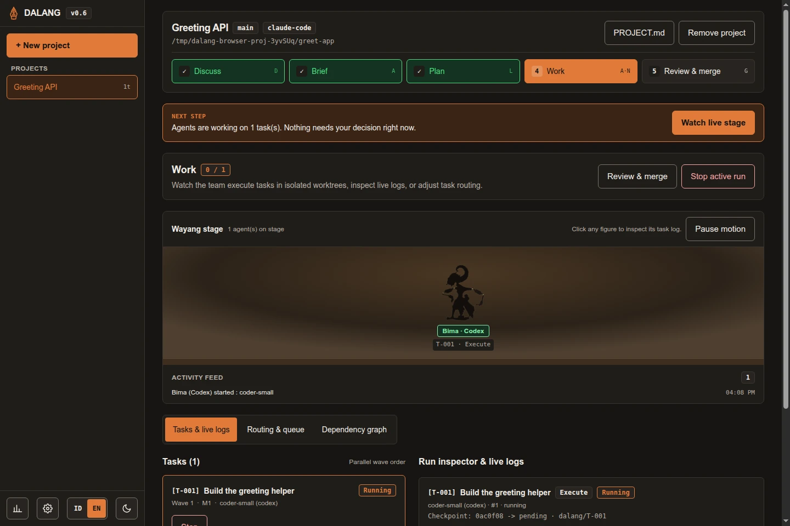
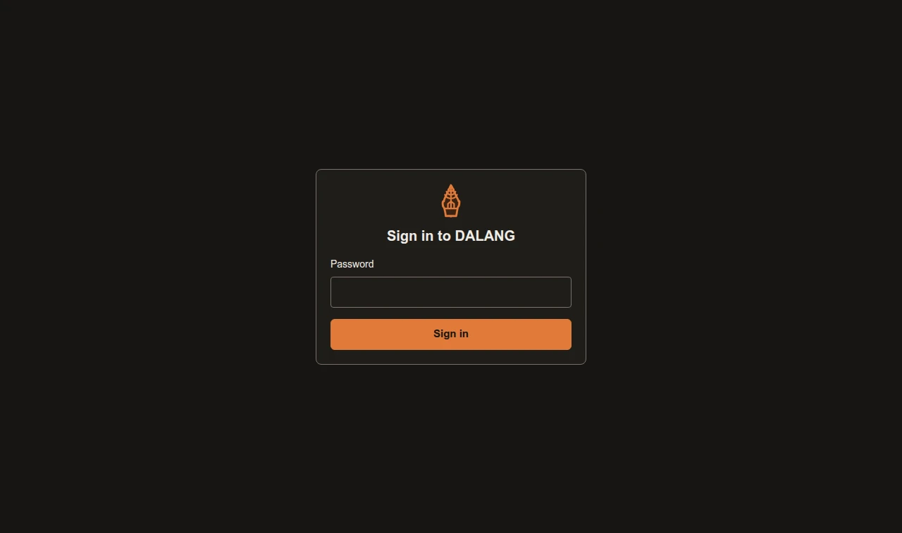

# Use Dalang

Start in Ask to explore a repository, use Quick for a one-task fix, or follow the Full walkthrough for work that needs a brief and a plan. Screenshots use demo repositories and replayed agent responses. [Install and start Dalang](INSTALL.md)

## Set up your team and project

On your first launch, the wizard checks your agent CLIs, proposes a team, and opens your first project. If an agent shows **LOGIN NEEDED**, sign in from your terminal and refresh the check. One signed-in provider can fill every role.

- **Lead (Semar)** asks questions and drafts the brief and task plan.
- **Coders (Bima and Kresna)** implement tasks. You can use different models for simple and complex work.
- **Reviewer (Arjuna)** checks the changes against the task. Pick a different provider from the coder if you want a cross-provider review.
- **Fallback** is an alternate CLI configuration Dalang can use when the primary cannot run.

Choose **New project** to initialize a folder with Git, or **Open existing repo** to work on an existing checkout. Enter the local folder path. Use the sidebar to switch projects or add another one later.

Dalang uses `PROJECT.md` for repository instructions and can link `CLAUDE.md` and `AGENTS.md` to it. Use the **PROJECT.md** button to review the file or check the links. Keep build commands, test commands, and project conventions here.

On native Windows without symlink privileges, Dalang creates instruction files that refer agents to `PROJECT.md`. Existing user-owned instruction files remain in place. The native Windows runner uses `cmd.exe` for task verification and integration; use Windows-compatible commands, or open the project from WSL 2 for POSIX commands.

## Choose Ask, Quick, or Full

A project opens into a chat with the Lead. Pick a mode beside the send button. Dalang saves the session when you send the first message.

| Mode | Use it for | What happens |
| --- | --- | --- |
| **Ask** (default) | Questions about the repository | The Lead reads the repository and answers in chat. Dalang saves the transcript and keeps technical logs in an ignored directory. |
| **Quick** | A small bug fix or feature | The Lead drafts a single task with allowed files, acceptance criteria, and a verify command. You run, review, and merge it from the chat. |
| **Full** | A larger change | You discuss scope, approve a brief and plan, then use the Work and Review views to run and merge tasks. |

### Ask about the code

The model chip beside the send button opens a picker for the provider, model, and reasoning effort. It starts with the project's Lead settings. While the Lead works, the chat shows the CLI name, elapsed time, progress, and any streamed reply. Expand **Show technical log** to inspect raw output.

### Attach images

Choose Claude Code or Codex, then click the paperclip at the lower left of the composer or paste an image. In Ask, Quick, and Full, send up to three PNG, JPEG, or WebP images per message, each up to 4 MiB. Write a prompt if you want to give the CLI extra context. Use the preview's **Remove** button to drop an image before sending. Dalang sends the images to the selected provider for that turn and keeps them in the chat transcript.

### Run a Quick fix

1. Select **Quick** and describe the change. Check the proposed task, allowed files, acceptance criteria, and verify command.
2. On native Windows, select **Run without sandbox confinement on this host** before clicking **Run**. Dalang runs the task in a Git worktree, executes the verify command, and runs automated review. Linux and macOS use their configured platform sandbox when available.
3. Open **Show diff** and inspect the review. Click **Approve & merge** when ready, or send the task back with feedback.

If the Lead finds the request needs a broader plan, use **Switch to Full (keeps findings)** to take the request and findings into Discuss.

### Continue or manage a chat

- Use **New chat** in the project sidebar or reopen a saved session to restore its conversation and work. Click the session title to rename it. The header also offers archive and delete actions, with a confirmation before deletion.
- Sending a higher-mode message can move a session from Ask to Quick or Full, or from Quick to Full. The conversation carries over. Ask stays available in both work modes and keeps the session's current mode. Quick becomes available again after Full work is complete.
- Only one session per project can hold unfinished work. Other sessions can still Ask. Finish merging the first session's work or use **Discard work** to free the project. Discarding stops its runs and removes unmerged task branches and worktrees. Merged code stays on the target branch.
- The desktop sidebar can collapse to an icon rail. Dalang remembers your choice. On small screens, use **Menu** to open the sidebar.

## Full walkthrough

## 1. Discuss the goal

Choose **Full** beside the send button and describe what should change, what must stay in scope, and how you will know it works. The model chip in the composer chooses the CLI and model for each message.

For example, send this goal in a small Node.js project.

> Add a greeting helper that returns a formatted message from a name. Include tests for normal and empty input. Keep the module dependency-free.

Click **Send** (the button reads **Send to Lead** once the discussion has started). Answer any question cards, add notes if needed, then click **Submit answers & continue**. When the goal is clear, click **Enough, write the brief**.

## 2. Approve the brief

In **Brief**, check the proposed scope, features, constraints, and assumptions. Edit the draft and click **Save edits**, or use **Revise with Lead** to ask for a new version. Click **Approve brief (Gate 1)** when it matches your intent, then **Generate plan**.

## 3. Approve the plan

In **Plan**, inspect tasks on the **Kanban** board or switch to the **Dependency graph**. Open a task to edit its goal, allowed files, dependencies, profile override, acceptance criteria, and verify command. The verify command should be a command you would run locally, such as `node --test`.

Break broad tasks into smaller ones with clear file boundaries. Use dependencies for work that must happen in order. Dalang queues independent tasks in parallel when capacity permits and holds back tasks with overlapping allowed files. Check all tasks, then click **Approve plan** and open **Work**.

## 4. Run the work

Click **Start work** to run the approved queue. Dalang uses a separate Git worktree for each task. The wayang stage and **Activity feed** show progress. Click a figure or select a task under **Tasks & live logs** to inspect its output, attempts, and changed files. **Routing & queue** shows profile assignments and fallbacks. **Dependency graph** shows execution waves and what is waiting.

- Use **Stop** for an individual task or **Stop all runs** for the queue. Stopping a parent task also stops any delegated subtasks it launched.
- During execution, a running coder can split independent parts of its task onto other profiles or providers via DALANG's local MCP server (`delegate_task`, `task_status`, `task_cancel`). Each subtask runs in its own worktree branched from the parent branch, passes verify and automated review, and merges back into the parent branch so the parent's review and Gate 2 diff include the combined result. Delegated subtasks appear under their parent task in **Tasks & live logs** and **Dependency graph**. Native CLI subagents (Claude `Task` tool calls and Antigravity batches) appear read-only in the run inspector.
- Use **Retry** for a failed or stopped task. Where **Resume session** is available, use it to continue the provider session.
- To restore a pre-run state, select the run and use **Rollback to pre-run checkpoint**. Dalang can refuse a rollback when it would lose uncommitted work or commits made outside Dalang. [Rollback troubleshooting](TROUBLESHOOTING.md)
- If the sandbox is unavailable, see **Config → Security** for platform setup. Dalang asks for explicit confirmation before running tasks without filesystem confinement. [Sandbox and permissions](SANDBOX.md)

## 5. Review and merge

After a coder finishes, Dalang runs the task’s verification and an automated review. Open **Review & merge** and select a task. Read the review findings, open **Show verify output**, and inspect the **Branch diff** before deciding.

- **Approve and merge** adds the task changes to the project’s target branch. Dalang refuses a merge only when an uncommitted file in the target repository is also changed by the task, leaving unrelated uncommitted edits intact. Dalang asks for a separate override if automated review failed.
- **Reject and send back** lets you leave feedback and optionally requeue the task for another attempt.
- Set the **Integration command** for project-wide checks, such as `npm test`. Run it after a merge using the checkbox, or manually with **Run integration suite**.

### Workspace projects with nested repositories

You can open a workspace folder whose top-level subdirectories are their own standalone Git repositories (for example, a workspace root that ignores `frontend/`, `backend/`, and `scheduling-service/`).

- At task start, Dalang creates the root worktree and one worktree per top-level nested repository at the same relative path, each branched from that repository's currently checked-out branch. Paths stay root-relative (`frontend/...`) across plans, `files_allowed`, verify commands, and prompts.
- Checkpoints, hidden refs, scope checks, review diffs, and rollbacks run per repository and are joined with the repository prefix. The **Review & merge** and **Quick** diff views label each repository.
- Gate 2 merges each changed repository into its base branch (one merge commit per changed repository). Unrelated uncommitted changes stay in place; a merge is refused only if an uncommitted file overlaps a file modified by the task. If a later repository fails to merge, earlier repositories are restored to their pre-merge commit with `git reset --keep`.
- Push and pull request actions push each changed repository to its own configured Git remote and open a PR per repository when requested.
- Delegated subtasks receive nested worktrees branched from the parent task's branches and merge back per repository. Git submodules and nested repositories below the top level are not managed as workspace repos.

On native Windows, post-merge integration needs explicit unconfined consent in the current view. Without confinement or consent, the check is marked **skipped**. You can grant consent and run it manually. Required task `result.json` files are orchestration metadata; their presence does not violate a task's application-file scope.

### Push or open a pull request

In **Remote push and pull request**, select the Git remote (usually `origin`). After approving a merge, you can push the branch or push and open a PR. You can also save post-merge defaults for the project. Pushing uses your normal Git credentials. Opening a PR also requires `gh auth login` and a branch with changes relative to the PR base. [Git troubleshooting](TROUBLESHOOTING.md#push-or-pull-request-fails-in-review-and-merge)

## Settings and statistics

| Where | What you can do |
| --- | --- |
| **Config → General** | Choose English or Indonesian for the UI and Lead/Reviewer output, set the theme, reopen the wizard, and manage quota refresh and update notifications. |
| **Config → Agents** | Check CLI versions, logins, model lists, and quotas. Use **Update CLI** to update an installed provider or **Refresh CLI status** after signing in. |
| **Config → Team** | Edit profiles, models, reasoning effort, account directories, fallback targets, timeouts, and parallel slots. |
| **Config → Task routing** | Order rules by role and task complexity. The first matching rule selects the primary and can set a fallback. |
| **Config → Security** | Enable or disable DALANG password login, check sandbox status, and manage the Linux Antigravity keyring opt-in. |
| **Config → About** | Check your version, look for updates, and open support docs. |
| **Statistics** | Filter Lead, execution, fix, and review runs by project and time window. See duration, failures, fallback events, reported tokens, and API-equivalent cost estimates. |

The provider limits bar shows the tightest five-hour and weekly windows each installed CLI reports. **Details** lists the available windows, reset times when reported, and a refresh button. Dalang refreshes when a run finishes and every five minutes while the page is visible. Choose three, five, or ten minutes in **Config → General**. [Providers and accounts](PROVIDERS.md)

When DALANG login is enabled, use the **Sign out** icon on the far right of the sidebar footer. [Set or disable the app password](INSTALL.md#require-a-dalang-password)

