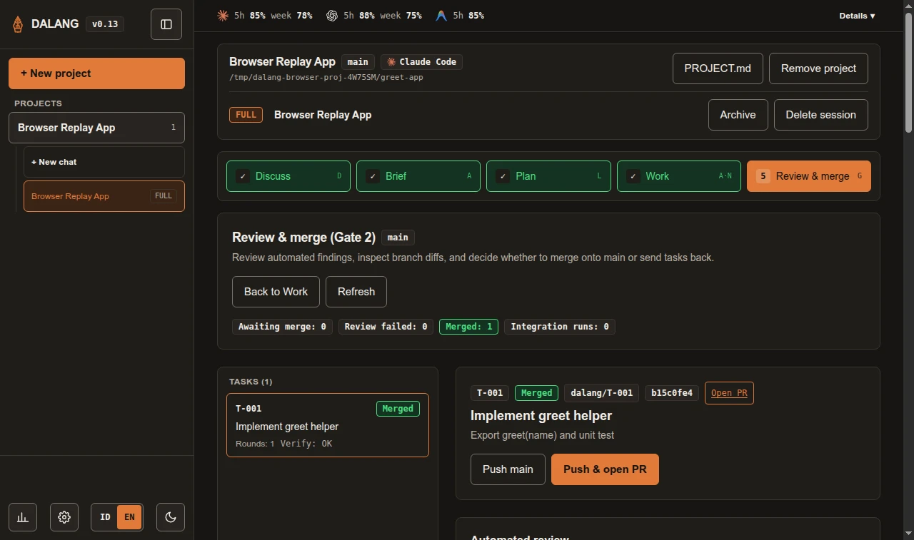

# Use Dalang

This walkthrough covers the three ways to work (**Ask**, **Quick**, and **Full**), then takes a small change through the Full flow: **Discuss**, **Brief**, **Plan**, **Work**, and **Review & merge**. The screenshots show Dalang running a demo project with replayed agent responses. They were taken before v0.7, so the sidebar and page header look different today. [Install and start Dalang](INSTALL.md)

## Set up your team and project

On your first launch, the wizard checks your agent CLIs, proposes a team, and opens your first project. If an agent shows **LOGIN NEEDED**, sign in from your terminal and refresh the check. One signed-in provider can fill every role.

- **Lead (Semar)** asks questions and drafts the brief and task plan.
- **Coders (Bima and Kresna)** implement tasks. You can use different models for simple and complex work.
- **Reviewer (Arjuna)** checks the changes against the task. Pick a different provider from the coder if you want a cross-provider review.
- **Fallback** is an alternate CLI configuration Dalang can use when the primary cannot run.

Choose **New project** to initialize a folder with Git, or **Open existing repo** to work on an existing checkout. Enter the local folder path. Use the sidebar to switch projects or add another one later.

Dalang uses `PROJECT.md` for repository instructions and can link `CLAUDE.md` and `AGENTS.md` to it. Use the **PROJECT.md** button to review the file or check the links. Keep build commands, test commands, and project conventions here.

## Choose Ask, Quick, or Full

A project opens into a chat with the Lead. The mode selector beside the send button decides how much process a message starts. No session exists until you send the first message.

| Mode | Use it for | What happens |
| --- | --- | --- |
| **Ask** (default) | Questions about the repository | The Lead answers read-only. Nothing in the repository changes. |
| **Quick** | A small bug fix or feature | The Lead returns one mini plan with a single task and the files it may touch, with no brief. Click **Run**. Verify, review, and the merge approval still apply. |
| **Full** | A larger feature | The five-step flow below, with the brief and plan approvals. |

- A new chat opens with a heading and the composer in the middle. Once there are messages, the conversation scrolls and the composer stays at the bottom.
- The model chip beside the send button opens a picker: choose a provider on the left, search and pick a model, and set the reasoning effort on the right. It starts from the project's Lead setting, and you can change it at any time. The choice applies to Ask, Quick, and the first Full message sent from this composer.
- Your question appears at once. While the CLI works you see its real name (for example Antigravity CLI), how long it has run, what it is doing (reading a file, searching, running a command), and the answer as it is written. The technical log is folded away under **Show technical log**. Replies are formatted: headings, lists, code, tables, and web links.
- The bar at the top of a project shows how much of each connected CLI's 5 hour and weekly limits is left. The numbers refresh every 5 minutes while the page is open (choose 3, 5, or 10 minutes in **Config**, **General**) and again when a run finishes. Click **Details** for every window, its reset time, and a refresh button. A value at 20% or below turns red.
- The button at the top of the sidebar minimizes it to a column of icons (new project, Statistics, Config, theme). Click it again to expand. Dalang remembers the choice.
- The mode buttons only choose what your next message does, so you can look at Quick or Full without changing anything. A session moves up (Ask to Quick or Full, Quick to Full) when you send a message in the higher mode, and the conversation carries over. Ask is always available, in any session, and never changes the session's mode. Quick is not offered inside a Full session until its work is finished. The Lead may suggest a switch with a button, and never switches on its own.
- If the Lead judges a Quick request too large, it says why and offers **Switch to Full (keeps findings)**.
- Each project lists its sessions in the sidebar, newest first, with **New chat** at the top. Open one to restore its conversation, brief, plan, and task board. Click the title to rename a session. You can archive or delete it. Deleting asks for confirmation and never touches merged code.
- Only one session per project can have unfinished work at a time. A second session can still chat in Ask mode, and can start work after the first one is merged or discarded with **Discard work**.

## 1. Discuss the goal

Choose **Full** beside the send button and describe what should change, what must stay in scope, and how you will know it works. The model chip in the composer chooses the CLI and model for each message.

For example, send this goal in a small Node.js project.

> Add a greeting helper that returns a formatted message from a name. Include tests for normal and empty input. Keep the module dependency-free.

Click **Send** (the button reads **Send to Lead** once the discussion has started). Answer any question cards, add notes if needed, then click **Submit answers & continue**. When the goal is clear, click **Enough, write the brief**.

## 2. Approve the brief

In **Brief**, check the proposed scope, features, constraints, and assumptions. Edit the draft and click **Save edits**, or use **Revise with Lead** to ask for a new version. Click **Approve brief (Gate 1)** when it matches your intent, then **Generate plan**.

## 3. Approve the plan

In **Plan**, inspect tasks on the **Kanban** board or switch to the **Dependency graph**. Open a task to edit its goal, allowed files, dependencies, profile override, acceptance criteria, and verify command. The verify command should be a command you would run locally, such as `node --test`.

Break broad tasks into smaller ones with clear file boundaries. Use dependencies for work that must happen in order. Dalang queues independent tasks in parallel when capacity permits and holds back tasks with overlapping allowed files. Check all tasks, then click **Approve plan** and open **Work**.

## 4. Run the work

Click **Start work** to run the approved queue. Dalang uses a separate Git worktree for each task. The wayang stage and **Activity feed** show progress. Click a figure or select a task under **Tasks & live logs** to inspect its output, attempts, and changed files. **Routing & queue** shows profile assignments and fallbacks. **Dependency graph** shows execution waves and what is waiting.

- Use **Stop** for an individual task or **Stop all runs** for the queue.
- Use **Retry** for a failed or stopped task. Where **Resume session** is available, use it to continue the provider session.
- To restore a pre-run state, select the run and use **Rollback to pre-run checkpoint**. Dalang can refuse a rollback when it would lose uncommitted work or commits made outside Dalang. [Rollback troubleshooting](TROUBLESHOOTING.md)
- If the sandbox is unavailable, see **Config → Security** for platform setup. Dalang asks for explicit confirmation before running tasks without filesystem confinement. [Sandbox and permissions](SANDBOX.md)

## 5. Review and merge

After a coder finishes, Dalang runs the task’s verification and an automated review. Open **Review & merge** and select a task. Read the review findings, open **Show verify output**, and inspect the **Branch diff** before deciding.

- **Approve and merge** adds the task changes to the project’s target branch. Dalang asks for a separate override if automated review failed.
- **Reject and send back** lets you leave feedback and optionally requeue the task for another attempt.
- Set the **Integration command** for project-wide checks, such as `npm test`. Run it after a merge using the checkbox, or manually with **Run integration suite**.

### Push or open a pull request

In **Remote push and pull request**, select the Git remote (usually `origin`). After approving a merge, you can push the branch or push and open a PR. You can also save post-merge defaults for the project. Pushing uses your normal Git credentials. Opening a PR also requires `gh auth login` and a branch with changes relative to the PR base. [Git troubleshooting](TROUBLESHOOTING.md#push-or-pull-request-fails-in-review-and-merge)

## Settings and statistics

| Where | What you can do |
| --- | --- |
| **Config → General** | Choose English or Indonesian for the UI and Lead/Reviewer output, set the theme, reopen the wizard, and manage update notifications. |
| **Config → Agents** | Check CLI versions, logins, model lists, and quotas. Refresh after installing a CLI or signing in again. |
| **Config → Team** | Edit profiles, models, reasoning effort, account directories, fallback targets, timeouts, and parallel slots. |
| **Config → Task routing** | Order rules by role and task complexity. The first matching rule selects the primary and can set a fallback. |
| **Config → Security** | Check sandbox status and manage the Linux Antigravity keyring opt-in. |
| **Config → About** | Check your version, look for updates, and open support docs. |
| **Statistics** | Filter runs by project and time window. See duration, failures, fallback events, token counts when available, and API-equivalent cost estimates. |

For account switching and routing examples, see [Providers and accounts](PROVIDERS.md). For where Dalang saves project data, see [Data and uninstall](INSTALL.md#data-and-uninstall).
